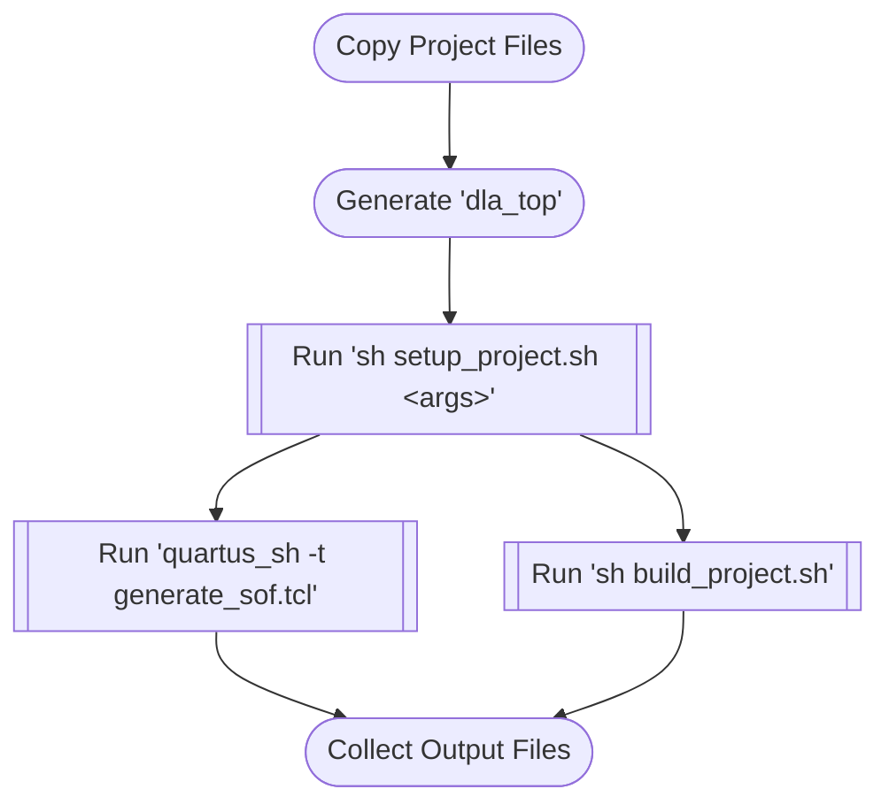

# DLA Example Designs

The ED projects are processed by [`dla_build_example_design`](scripts/dla_build_example_design.py)
utility.

## ED Project Structure

A ED project is a directory that contains the following files:

| Required Files | Description |
| ---------------|-------------|
| `example_design.json` | Metadata describing the example design project.  Any directory with an `example_design.json` file is treated as an example design project. |
| `setup_project.sh` | Calls any scripts or utilities that are necessary to prepare the project for publishing or compilation.  This *may not* call into Quartus and should not perform any sort of "pre-compilation" steps, such as setting up a Qsys system.  Use `generate_sof.tcl` or `build_project.sh` for any Quartus-specific configuration steps.  |
| `generate_sof.tcl` | A TCL script used to drive the Quartus compilation. Cannot be used with `build_project.sh`.  |
| `build_project.sh` | A shell script that will invoke Quartus, or any tools that in turn invoke Quartus, to build a bitstream.  Cannot be used with `generate_sof.tcl`. |

Any other files in this same directory will be considered to be part of the
example design during a build.  This includes a README or `.gitignore` file.
More information about the scripts can be found in [Compile Scripts](#compile-scripts).

### Metadata Format

The ED metadata is stored in a JSON file similar to the example shown below:

```json
{
    "name": "PCIe-Attached Example Design",
    "description": "Demonstrates ML inference using the Terasic DE10-Agilex Development Board",
    "max_instances": 4,
    "output_files":
    [
        {
            "file": "hw/flat.sof",
            "type": "bitstream"
        }
    ],
    "project_info":
    {
        "board": "",
        "device_name": "AGFB014R24B2E2V",
        "family": "Agilex 7"
    }
}
```

It is used to provide:

* A listing of all of the build artifacts that the ED project will create.
* Specific information about the ED project itself, such as the device family,
  target board, supported OS, supported Quartus version(s), expected OFS version (if OFS-based), etc.
* Any human-friendly display information, such as a short description.

The [JSON schema](https://json-schema.org/) for the ED metadata format can be
found in [`example_design.json`](../scripts/dla_example_design_utils/schema/example_design.json).

## Project Compile Flow

An ED bitstream can be compiled with

```sh
# This example will compile the DE10 PCIe-attach example design using the
# AGX7_Performance architecture.
dla_build_example_design.py build agx7_de10_pcie $COREDLA_ROOT/example_architectures/AGX7_Performance.arch
```

This is what it will do:

1. Creates a build directory.  By default, called `build_project`.
2. Generates the RTL for the provided architecture file.  In this example, `AGX7_Performance.arch`.
   Under-the-hood it's calling `dla_compile_ip` to do the work.  The generated IP will be in
   `build_project/coredla_ip`.
3. Loads the project metadata for the `agx7_de10_pcie` ED project.
4. Stages (i.e. prepares) the design for compilation.  This will:
   1. Copy the project directory to `build_project/hw`.  All files in the source
      platforms directory are copied over.
   2. Copy the DLA IP into `build_project/hw`.  This ensures that the contents
      of `hw` are self-contained.
   3. Copy any TCL build utilities into the `hw` directory.
   4. Generate the `dla_top` platform wrapper.  This includes creating the
      requested number of instances (defaults to the maximum supported number
      of instances).
   5. Runs `setup_project.sh`, if it exists, to prepare the ED Quartus project.
5. Launches the Quartus compile.
   * Performs compatibility checks (Quartus version, OS, OFS) before launching. Read [Compatibility Checks](#compatibility-checks) for more details.
   * The script will look for either `generate_sof.tcl` or `build_project.sh`.
     Only one of these scripts may exist in a valid ED project directory.
   * Any output files listed in the `output_files` metadata property are
     collected and copied to `build_project/hw`.
6. Creates a QoR report by parsing the various Quartus .rpt files and a special
   `dla_compile_report.json` file.
   * `dla_compile_report.json` should be generated by the build script.

> [!NOTE]
> The utility has the notion of a "build context".  It is possible to split the
> build process into the following commands:
>
> ```sh
> dla_build_example_design.py build --skip-compile agx7_de10_pcie $COREDLA_ROOT/example_architectures/AGX7_Performance.arch
> dla_build_example_design.py quartus-compile build_platform
> dla_build_example_design.py qor build_platform
> ```
>
> The context is not portable and specific to the project build folder.

### Compile Scripts

The compile scripts are called by `dla_build_example_design.py` in the order
outlined in the [Project Compile Flow](#project-compile-flow).



#### setup_project.sh

**Description**
> [!IMPORTANT]
> This script *must not* perform any Quartus calls or assume that Quartus is
> available.  The `--skip-compile` option must work even when there is no
> available Quartus installation.

The `setup_project.sh` script performs the post-copy project setup to convert
the original ED project directory into a valid Quartus or OFS project.  Command
line arguments containing the architecture name and IP path are passed to the
script by `dla_build_example_design.py`.  The call is equivalent to

```bash
sh setup_project.sh arch_ip_name dla_ip_dir
```

**Arguments**

| Argument | Description |
|----------|-------------|
|`arch_ip_name`|The architecture IP name.  E.g., `AGX7_Performance_AGX7`.|
|`dla_ip_dir`|Path to the directory containing the DLA IP.|

#### generate_sof.tcl

The `generate_sof.tcl` script is used for "Quartus-only" bitstream compiles.
This script should be used if building the bitstream does not require any
tooling besides quartus.  Once configured with `setup_project.sh`, running

```sh
quartus_sh -t generate_sof.tcl
```

or invoking the script in Quartus should start the bitstream compilation
process.

**Arguments**

None

#### build_project.sh

The `build_project.sh` script is used for "generic" bitstream compilation.  This
allows more complicated build flows, such as the SoC S2M example design, which
requires a separate pre-compile step outside of the bitstream compilation.

**Arguments**

None

### OFS-based Projects

OFS-based EDs have a slightly different build flow than non-OFS EDs.  First, to
mark a ED as being OFS-based, set

```json
"project_info": {
   "ofs_version": "2024.3"
}
```

(replace `2024.3` with the OFS version) inside of the `example_design.json` file.  This will cause
`dla_build_example_design.py` to first use an `ofs_common` project as the
source for `build_project/hw`.  The contents of the ED project directory will
then be copied to `build_project/hw` immediately afterwards. Additionally, during compilation, it will check that the installed OFS version matches this version. More details in [Compatibility Checks](#compatibility-checks).


> [!IMPORTANT]
> OFS-based projects do not support `generate_sof.tcl` scripts.

An `ofs_build_env` script is provided to assist with configuring the OFS build
environment, including ensuring that the correct environment variables are set.
This is done by adding

```bash
source ./ofs_build_env
init_ofs_build_env
```

at the very top of a compile script.  This will make OFS utilities such as
`afu-synth` avaialble to the compile script.

#### Support Functions

| Function | Description |
|----------|-------------|
| `init_ofs_build_env` | Ensures the local shell is prepared to compile an OFS AFU bitstream. |
| `check_opae_root` | Check if the `OPAE_PLATFORM_ROOT` environment variable is set, erroring out if it is not. |
| `check_ofs_util <util>` | Check if `<util>` is available in the local shell, erroring out if it is not. |

### QoR Reporting

The ED build process will generate a QoR report after compiling a bitstream.
The data for the QoR report comes from two sources: the .rpt report files
generated by Quartus and a `dla_compile_report.json` file that is expected to be
produced by either `generate_sof.tcl` or `build_project.sh`.

The `dla_compile_report.json` contains platform and device-specific QoR
information, such as the number of total available ALMs and platform clock
frequency.  The data is extracted by a `dla_parse_report.tcl` script that must
run after the bitstream compilation.

The values for the IP Frequency and IP Fmax (as determined by the `-ip-clock` argument) are added to the `QOR Summary` table as `Actual AI Suite IPs Clock Frequency` and `AI Suite IP Fmax` respectively.

The usage differs depending on which of the two compile scripts are used.

**generate_sof.tcl**
```tcl
source dla_parse_report.tcl
set clock "board_inst|kernel_clk_gen|kernel_clk_gen|kernel_pll_outclk0"
dla_parse_report -project flat -ip-clock $clock -platform-clock $clock
```

**build_project.sh**
```bash
# Generate a compile report JSON from inside of 'build_project.sh'.
clock="board_inst|kernel_clk_gen|kernel_clk_gen|kernel_pll_outclk0"
quartus_sh -t dla_parse_report.tcl -project flat -ip-clock $clock -platform-clock $clock
```

#### dla_parse_report

| Argument | Description |
|----------|-------------|
| `-project <name>` | Quartus project name.  Defaults to 'top'. |
| `-revision <name>` | Project revision name. |
| `-ip-clock <clock>` | The clock driving the DLA IP.  It is used to obtain the IP's clock frequency and Fmax. |
| `-platform-clock <clock>` | The clock driving the entire FPGA system.  This may be different than the IP clock, as is the case for SoC designs. |


### Compatibility Checks

In `dla_build_example_design.py`, before the Quartus compile, the following checks will be performed:

1. Check that the user's Quartus version is supported by the example design.
   1. In the example design's JSON file, if `strict` is true under `project_info/quartus`, then major and minor version has to match `project_info/quartus/version` directly.
   2. Otherwise, the major version must be greater, or the major version must match and the minor version is greater or equal.
2. Check that the user's OS is supported by the example design.
   1. In the example design's JSON file, `properties/os_support` stores a list of supported OS. If it doesn't exist, no OS compatibility check will be performed.
   2. Otherwise, it will check that the OS family and distribution (if applicable) matches, then checks OS version:
   3. Checks first if the major version matches exactly, then checks if the minor version is greater or equal. If no minor version provided in the example design JSON, don't perform the minor version check.
   4. If no compatible OS found, the script will display a warning.
3. If the ED is OFS-based, then check that the user's OFS version matches the ED's exactly.
   1. Checks the following files for the Quartus version of the user's OFS installation: `$OPAE_PLATFORM_ROOT/hw/lib/build/quartus_proj_dir/ofs_top.qpf` and `$OPAE_PLATFORM_ROOT/hw/lib/build/quartus_proj_dir/ofs_top.qsf`.
   2. Checks if this Quartus version matches the specified OFS version in the ED's JSON.

